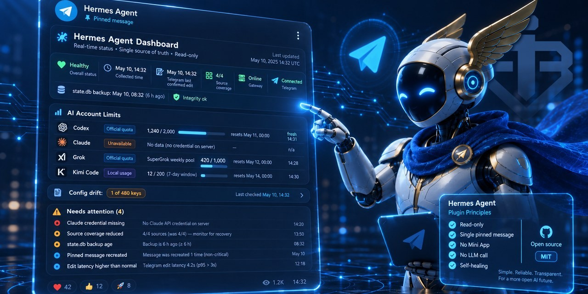
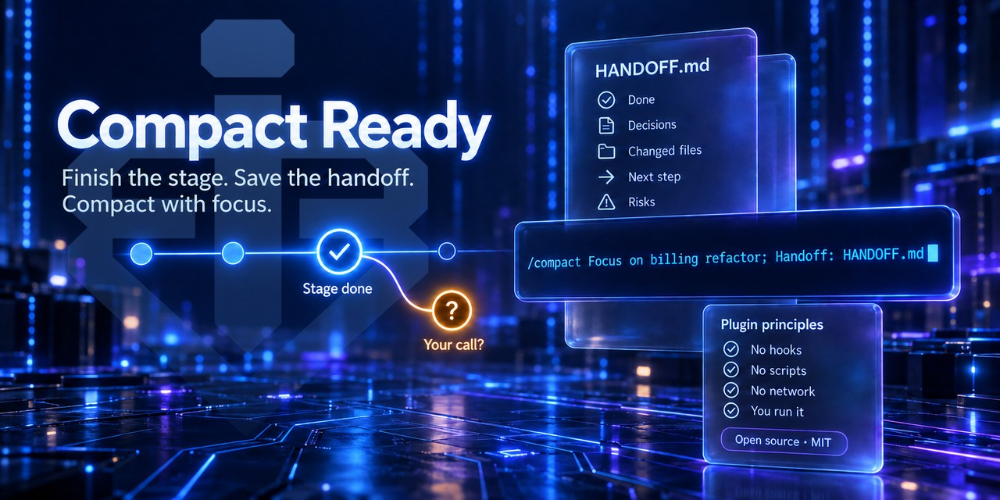

<a href="https://x.com/bablobanov"></a>

<a href="https://bablobanov.com"></a> <a href="https://x.com/bablobanov"></a> <a href="https://bsky.app/profile/bablobanov.com"></a> <a href="https://www.threads.com/@bablobanov_com"></a> <a href="https://huggingface.co/bablobanov"></a>

I run AI agents in real business. This account holds the part of that work that can be verified by anyone: the tooling, the tests, and the failure reports.

## hermes-agent-telegram-checklist

<a href="https://github.com/bablobanov/hermes-agent-telegram-checklist"></a>

Native Telegram To-Do lists for AI agents - create, read, append and toggle real interactive checklist messages in chats and forum topics through a Telethon user session.

**Why it exists.** Telegram's Bot API sends checklists only on behalf of a connected business account, and its checklist methods take no forum-topic parameter, so a regular bot has no documented way to post one into a team group or a forum topic. MTProto under a user session can, which is what this tool does.

**What it is.** A single-file Python CLI - stdlib plus Telethon, strict JSON in and out, no daemon, no background listener, no message scraping. It ships as a skill for the Hermes agent by Nous Research, but any agent harness or plain shell can call it.

<a href="https://github.com/bablobanov/hermes-agent-telegram-checklist"></a> <a href="https://github.com/bablobanov/hermes-agent-telegram-checklist/releases/latest"></a> <a href="https://github.com/0xNyk/awesome-hermes-agent"></a>

Install: `npx skills add bablobanov/hermes-agent-telegram-checklist`

## hermes-agent-telegram-dashboard

<a href="https://github.com/bablobanov/hermes-agent-telegram-dashboard"></a>

A read-only status dashboard for the Hermes agent, kept in one pinned Telegram message and edited in place on a schedule: gateway health, message freshness, the last database backup, config drift, and the Claude, Codex, Grok and Kimi account limits.

**Why it exists.** Hermes can report each of these through its own commands, one at a time, which adds up to a dozen small actions. I wanted one message that stays on screen in the chat I already work in and reads at a glance. A Mini App or a web page would put the effort into sign-in, hosting and layout, the parts that rot first, and an updater with a bot of its own would mean a second token to create and guard. A pinned message needs none of that.

**What it is.** A plugin that runs inside the Hermes gateway and edits the message through the gateway's own Telegram adapter, so the bot token never leaves the engine. No LLM calls, nothing installed into the engine's environment; it needs Hermes 0.21.1 or later. The screen text is in English.

<a href="https://github.com/bablobanov/hermes-agent-telegram-dashboard"></a> <a href="https://github.com/bablobanov/hermes-agent-telegram-dashboard/releases/latest"></a> <a href="https://hermes-agent.nousresearch.com/docs/plugins/telegram_dashboard_probe"></a>

- Install: `hermes plugins install telegram_dashboard_probe`, or from a clone with the command below; then enable the plugin in `config.yaml`, restart the gateway and pin the message it sends:

  ```bash
  git clone https://github.com/bablobanov/hermes-agent-telegram-dashboard.git && cd hermes-agent-telegram-dashboard && install -d "${HERMES_HOME:-$HOME/.hermes}/plugins" && cp -r plugin/telegram_dashboard_probe "${HERMES_HOME:-$HOME/.hermes}/plugins/"
  ```

## hermes-agent-alice-voice

<a href="https://github.com/bablobanov/hermes-agent-alice-voice"></a>

Voice input for the Hermes agent: a private Yandex Alice skill passes the recognized text of a task to one existing Hermes Telegram chat, and the result arrives in Telegram.

**Why it exists.** Alice is the voice assistant on my Android phone and on my smart speaker. Sometimes I do not want to go looking for the phone, so I reach the agent straight through the speaker: "Alice, tell Hermes…". It is simply the more comfortable way for me. Alice only hands the task over; the agent answers in the Telegram chat where its other results already arrive. Version 0.3.0 does this without patching Hermes: it uses the engine's existing plugin call for injecting a message.

**What it is.** A plugin inside the Hermes gateway, Python standard library only. It listens on 127.0.0.1 behind an HTTPS proxy you run, takes requests on a secret URL, and passes the text to one Telegram direct-message session fixed in the configuration; a request cannot pick another session, role, model or tools. Alice's reply means the task was scheduled, not that it was done, and Alice does not read the result aloud. Built for one operator and a private skill; Alice's replies are in Russian.

<a href="https://github.com/bablobanov/hermes-agent-alice-voice"></a> <a href="https://hermes-agent.nousresearch.com/docs/plugins/alice-voice"></a>

- Install: `hermes plugins install alice-voice`, or copy the three files of `plugins/alice-voice/` into the Hermes plugin folder; then set a webhook secret in the Hermes `.env` and the plugin settings in `config.yaml`, point a private Alice skill at your HTTPS proxy and restart the gateway. The repository README has each step.

## compact-ready

<a href="https://github.com/bablobanov/compact-ready"></a>

A Claude Code command for the moment before `/compact`: it finishes the current stage of the plan or stops where it needs your decision, writes a handoff file next to the task, and prints one ready-to-paste `/compact` line with a focus. It never runs `/compact` itself.

**Why it exists.** Automatic compaction starts near the context limit and writes a general summary. A `/compact` line with a clear focus gives a cleaner continuation, but it has to be remembered and written, and by then the work is often half done. This command closes the current piece of work first, saves the state to a file, and writes the line.

**What it is.** A plugin with one skill: a single instruction file, no hooks, no scripts, no network code of its own. Claude cannot start it by itself (`disable-model-invocation: true`), only you can. The handoff file has five sections: done, decisions and why, changed files, next step, risks. Claude Code only; Cowork and the desktop app are not tested.

<a href="https://github.com/bablobanov/compact-ready"></a>

- Install, in Claude Code:

  ```
  /plugin marketplace add bablobanov/compact-ready
  /plugin install compact-ready@bablobanov
  ```

## How the work is checked

Test counts as of 9 October 2026.

The interesting part of an agent tool is not that it runs, it is what happens when it does not. Three of the four projects run their checks in GitHub Actions on every push. compact-ready has no code of its own, so it was checked by running it.

**hermes-agent-telegram-checklist**

- the same 150-test suite on Python 3.9, 3.11 and 3.13 with neither network nor Telethon, and on Python 3.12 with the real Telethon installed, where an integration test that skips elsewhere checks the exact MTProto request signatures against the library
- an allowlist on every command, reads included; the chat check runs offline, before any network call
- offline validation of an agent-researched plan before a single write happens
- every write is read back from the server and reported under `verified`
- a documented security policy and a private channel for vulnerability reports

**hermes-agent-telegram-dashboard**

- 924 tests pass offline on Python 3.11, 3.12, 3.13 and 3.14, plus `ruff` and `mypy --strict`; the tests that drive the plugin through the real engine objects need the engine installed, so CI skips them
- an invariants test reads the plugin's own source and pins thirteen properties a later change cannot undo quietly, among them: the bot token is never read, no port is listened on, the run history and `state.db` are opened read-only, no hook, tool or command is registered
- a manifest check: `SHA256SUMS` must match every file of the plugin folder, and nothing unlisted may ship with it
- a value the dashboard cannot prove is shown as `unknown`, a source this installation does not have as `unsupported`; neither is ever drawn as zero, and a limit line without a number names its reason
- a freshness stamp: the screen carries the time its data was read and the time Telegram last confirmed the edit, a number read at another minute is named in the details with its own time, and a message not confirmed for two periods gets a banner on its first line
- a watchdog outside the plugin checks the message's freshness on a schedule and alerts when the plugin stops editing. It runs in the same gateway, so it covers a dead plugin, not a dead gateway
- a private channel for vulnerability reports

**hermes-agent-alice-voice**

- 15 tests on Python 3.11, 3.12 and 3.13, 11 for the bridge and 4 for the controls, with synthetic IDs and no Telegram or Yandex connection
- an optional test for a real Hermes runtime first checks three engine source files against their recorded SHA-256 and skips on any other tree; CI has no engine, so it skips there, and a skip is not counted as a pass
- the route is fixed by configuration: a request cannot choose the session, role, model or tools, and leading slash commands and control characters are rejected
- the listener binds to 127.0.0.1 and opens only when the gateway connects to Telegram; importing the plugin opens no port
- the README names what is not protected: the Yandex request signature is not verified, and retry protection is an in-memory cache of the last 32 requests, not exactly-once delivery
- a documented security policy
- a private channel for vulnerability reports

**compact-ready**

- installed as a plugin and run in headless Claude Code sessions on Sonnet and Opus, in test projects separate from my own work
- nine scenarios, among them a call in the middle of a stage, an empty session, two task folders with the work tied to neither, continuing after `/compact` with the printed line, and a direct request to Claude to run it by itself, which Claude Code refused
- a separate AI reviewer read the text, and an independent check went over the run logs
- a documented security policy and a private channel for vulnerability reports

The design rule I care about most is the same in all four: the output says what actually happened, not what was intended. Alice says a task was accepted, not that it was done. A pinned dashboard with a dead updater looks exactly like a calm system, and that is the failure it exists to prevent.

## Running agents in production

A personal agent has been running on my own server since 17 June 2026 - inbox and channel monitoring, scheduling, document preparation. About ten jobs run on a recurring schedule, plus one-off jobs that fire once after a specific event. One user: me. The dashboard above has been running on this same agent since 11 September 2026.

Along the way it surfaced three failures that had been silent for weeks: file delivery that dropped messages without an error, image sending that had never once succeeded across the entire log, and a cache cleanup quietly eating artefacts. None of them reported themselves. I write these down because a report that only lists wins is not a report.

## Attribution

My part is the requirements, the acceptance criteria, the security and quality decisions, the review, and running the result in production. The code and texts of all four projects are written with AI assistance. The histories show it differently:

- hermes-agent-telegram-checklist: six of its nine non-merge commits carry an AI co-author trailer (`Co-Authored-By: Claude`), the latest one among them
- hermes-agent-telegram-dashboard, hermes-agent-alice-voice and compact-ready: none of their commits carries one. I no longer add AI trailers to my repositories and say it here in words instead; a missing trailer is a choice about commit metadata, not a claim about who wrote the code
- the public history of the dashboard starts with one commit that holds all the work up to version 0.3.0, and that of hermes-agent-alice-voice starts at version 0.3.0; the work before them is not public

I do not rewrite published history to make a profile look better.
